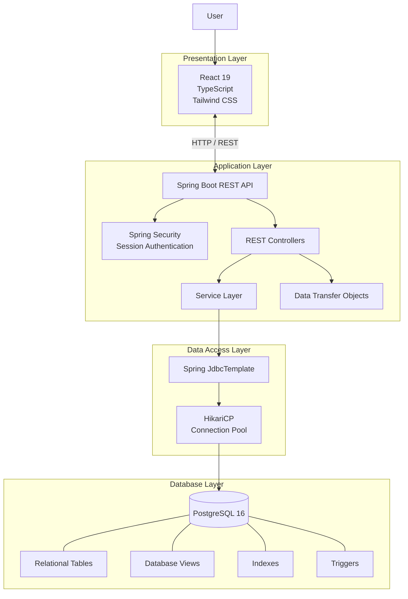
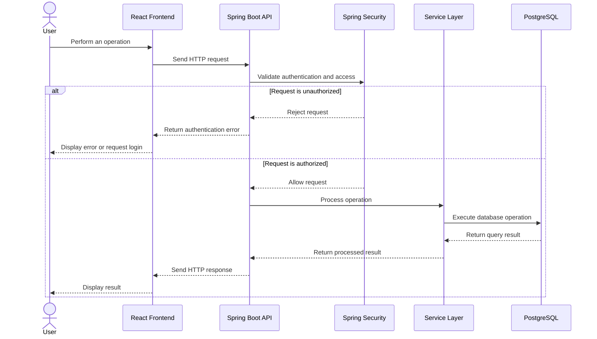
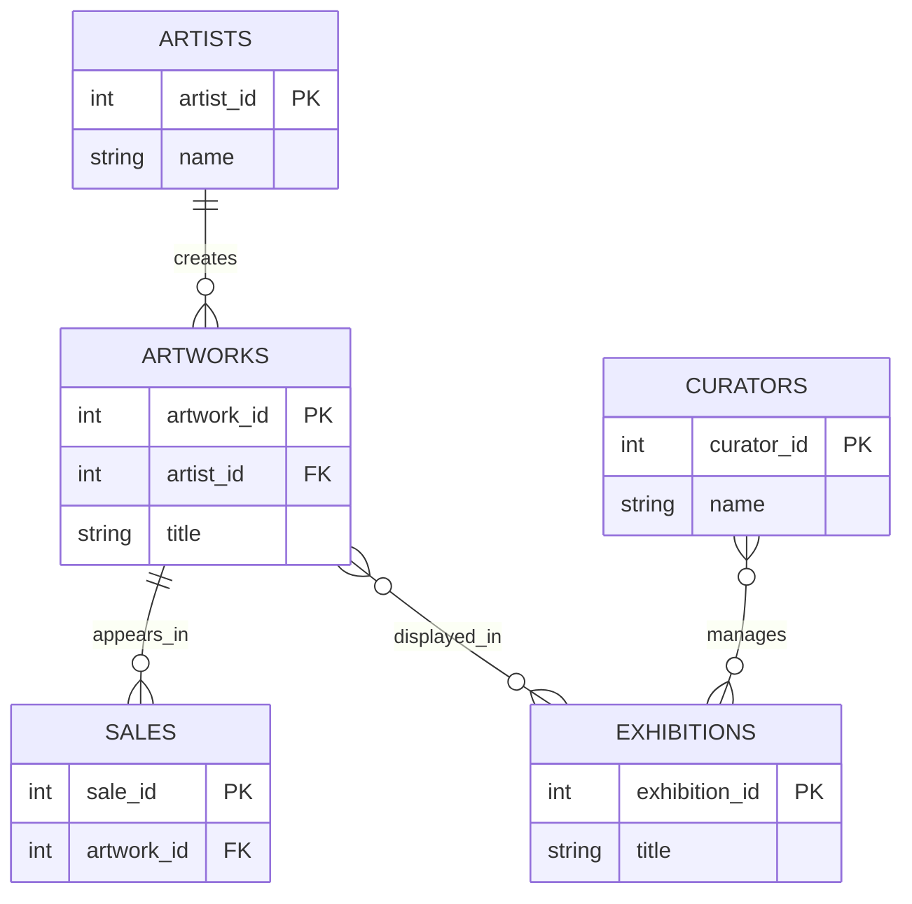
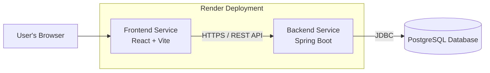

# ArtGalleryDB

**A Full-Stack Art Gallery Database Management System**

ArtGalleryDB is a full-stack database management workbench designed to manage the operations of an art gallery. It provides a structured platform for managing artists, artworks, curators, exhibitions, and sales through a modern web interface backed by a relational PostgreSQL database.

The project demonstrates the practical application of Database Management System (DBMS) concepts, including relational schema design, SQL queries, database views, indexing, constraints, and transaction-oriented operations, within a functional web application.

---

## Table of Contents

- [Features](#features)
- [Technology Stack](#technology-stack)
- [System Architecture](#system-architecture)
- [Application Workflow](#application-workflow)
- [Database Design](#database-design)
- [Getting Started](#getting-started)
- [Testing](#testing)
- [Deployment](#deployment)
- [Security Considerations](#security-considerations)
- [Project Objectives](#project-objectives)
- [Future Enhancements](#future-enhancements)
- [Contributors](#contributors)
- [License](#license)

---

## Features

- **Artist Management** — Organize and manage artist records.
- **Artwork Management** — Maintain artwork information and associated records.
- **Curator Management** — Manage curator information.
- **Exhibition Management** — Organize exhibitions and their associated records.
- **Sales Management** — Maintain and manage artwork sales records.
- **SQL Query Execution** — Interact with the database through SQL queries.
- **Query History** — Access previously executed queries.
- **Database Views** — Work with relational views for structured data access.
- **User Authentication** — Secure authentication using Spring Security and BCrypt password hashing.
- **RESTful API** — Communicate between the frontend and backend through REST endpoints.
- **Connection Pooling** — Manage database connections efficiently using HikariCP.
- **Responsive User Interface** — Interact with database functionality through a React-based web interface.

## Technology Stack

| Component | Technology |
|---|---|
| Frontend | React 19 |
| Programming Language | TypeScript |
| Build Tool | Vite 8 |
| Styling | Tailwind CSS |
| Backend | Java 21 |
| Backend Framework | Spring Boot 3.5.6 |
| Database | PostgreSQL 16 |
| Database Connectivity | JDBC, Spring JdbcTemplate |
| Connection Pooling | HikariCP |
| Authentication | Spring Security, BCrypt |
| Build and Dependency Management | Maven |
| Testing | JUnit and Spring Boot testing infrastructure |
| Deployment | Render |

---

## System Architecture

ArtGalleryDB follows a multi-tier architecture that separates the presentation layer, application logic, and data persistence layer.

The frontend communicates with the Spring Boot backend through REST APIs. The backend processes requests, enforces application security, and interacts with PostgreSQL through Spring JdbcTemplate and HikariCP.



### Frontend

The frontend is developed using React and TypeScript, with Vite providing the development server and production build process. Tailwind CSS is used for styling the application.

### Backend

The backend is implemented in Java using Spring Boot. REST controllers handle incoming API requests, while service classes organize application logic and DTOs support structured data transfer.

### Data Access

Spring JdbcTemplate provides database access and SQL execution capabilities. HikariCP manages the database connection pool.

### Database

PostgreSQL provides persistent relational storage for application data. The database incorporates tables, views, indexes, and triggers to support data management and demonstrate relational database concepts.

### Security

Spring Security handles application authentication and session-based access. BCrypt is used to hash passwords rather than storing them in plaintext.

---

## Application Workflow

The following diagram illustrates the typical interaction between a user, the frontend, the backend, and the database.



This sequence represents the general application request lifecycle. The exact authentication requirements depend on the endpoint and its security configuration.

---

## Database Design

The database is designed around the core entities and operations of an art gallery.

### Core Entities

| Entity | Purpose |
|---|---|
| Users | Stores application user and authentication-related information. |
| Artists | Maintains artist records. |
| Artworks | Stores artwork information and associated details. |
| Curators | Maintains curator records. |
| Exhibitions | Stores exhibition-related information. |
| Sales | Maintains artwork sales records. |
| Query History | Stores information about previously executed queries. |

The database also incorporates relational views, indexes, and triggers to demonstrate additional database design and management concepts.

### Conceptual Data Model

The following diagram illustrates a high-level conceptual relationship between the principal art gallery entities.

**Note:** This is an illustrative conceptual model, not a verified representation of the actual database schema. The relationships and cardinalities must be aligned with the implemented tables, foreign keys, and constraints before being treated as the authoritative ER diagram.



### Database Concepts

The project provides a practical environment for exploring database concepts such as:

- Relational schema design.
- Primary keys and foreign key constraints.
- SQL data retrieval and manipulation.
- Joins, subqueries, grouping, and aggregation.
- Database views.
- Indexing and query performance.
- Triggers and automated database operations.
- Database connectivity and connection pooling.

The precise features available depend on the implemented schema, SQL scripts, and backend functionality.

---

## Getting Started

Follow these steps to run ArtGalleryDB locally.

### Prerequisites

Ensure that the following software is installed:

- Node.js and npm.
- Java 21 JDK.
- PostgreSQL 16.
- Maven, or the project's Maven Wrapper if included.
- Git.

### 1. Clone the Repository

```bash
git clone <YOUR_REPOSITORY_URL>
cd ArtGalleryDB
```

Replace `<YOUR_REPOSITORY_URL>` with your GitHub repository URL.

Confirm the repository structure before proceeding. The commands below assume the backend and frontend are located in the directories shown.

### 2. Set Up the Database

Start PostgreSQL and create the application database.

```sql
CREATE DATABASE artgallery_db;
```

Create the required tables, views, indexes, triggers, and initial records using the SQL scripts included in the repository.

For example, if the project provides a schema initialization script, execute it using the appropriate PostgreSQL command.

```bash
psql -U <DB_USERNAME> -d artgallery_db -f <SCHEMA_FILE_PATH>
```

Replace the placeholders with the actual database username and SQL file path.

If the repository already contains a complete database initialization procedure, follow that procedure instead.

### 3. Configure the Backend

Navigate to the backend directory.

```bash
cd backend
```

Configure the PostgreSQL connection and other required settings using the backend's environment variables or application configuration.

Example configuration:

```properties
spring.datasource.url=${DATABASE_URL}
spring.datasource.username=${DB_USERNAME}
spring.datasource.password=${DB_PASSWORD}
```

This example illustrates the configuration pattern. Adapt the property names and connection URL format to match the actual backend implementation.

Do not commit database passwords, API keys, or other secrets to GitHub.

### 4. Run the Backend

If the project includes the Maven Wrapper, run:

```bash
./mvnw spring-boot:run
```

Otherwise, use:

```bash
mvn spring-boot:run
```

The backend will start on the port configured by the application.

### 5. Configure and Run the Frontend

Open a new terminal and navigate to the frontend directory from the repository root.

```bash
cd artgallery-dbms-workbench
```

Install the dependencies:

```bash
npm install
```

Configure the frontend environment variables according to the project's existing configuration.

For example, if the application uses a Vite environment variable for its backend API:

```env
VITE_API_BASE_URL=<YOUR_BACKEND_API_URL>
```

Replace the placeholder with the appropriate backend URL.

Start the development server:

```bash
npm run dev
```

Open the local URL displayed in the terminal to access the application.

---

## Testing

The backend includes integration tests for validating application functionality.

To run the backend test suite from the backend directory:

```bash
./mvnw test
```

Alternatively, if Maven is installed:

```bash
mvn test
```

Tests that require a live database may need a correctly configured PostgreSQL instance and the appropriate test environment.

---

## Deployment

ArtGalleryDB uses Render for deployment.

The application is divided into independently deployable frontend and backend components, with PostgreSQL providing persistent storage.



### Deployment Configuration

Before deployment, configure:

- The frontend build and deployment settings.
- The backend build and startup commands.
- PostgreSQL connectivity.
- Required environment variables and credentials.
- CORS settings for the deployed frontend origin.
- The frontend's backend API endpoint.
- Session-cookie and HTTPS settings.

Replace the placeholders below with the actual deployed URLs.

| Component | URL |
|---|---|
| Live Application | `<FRONTEND_RENDER_URL>` |
| Backend API | `<BACKEND_RENDER_URL>` |
| Source Code | `<GITHUB_REPOSITORY_URL>` |

---

## Security Considerations

- Passwords are hashed using BCrypt.
- Authentication is implemented using Spring Security and session-based authentication.
- Database operations should use parameterized queries to reduce SQL injection risks.
- Credentials and other secrets should be supplied through environment variables or secure deployment configuration.
- CORS should be configured to permit only the intended frontend origins in production.
- Production deployments should use HTTPS and appropriately configured session-cookie security attributes.
- Access to SQL execution functionality should be restricted according to the application's authorization requirements.

---

## Project Objectives

ArtGalleryDB aims to bridge theoretical database concepts with practical application development.

The project demonstrates:

1. Relational database design and data organization.
2. SQL-based data retrieval and manipulation.
3. Database connectivity using JDBC and Spring JdbcTemplate.
4. Backend development using Java and Spring Boot.
5. Frontend development using React and TypeScript.
6. Authentication and application security.
7. Integration of a relational database with a full-stack application.
8. Deployment of a multi-tier web application.

---

## Future Enhancements

Potential future improvements include:

- Expanded reporting and analytics.
- More comprehensive database performance monitoring.
- Enhanced query execution and result visualization.
- Improved database schema exploration.
- Additional role-based access controls.
- Expanded automated testing and deployment workflows.

---

## Contributors

**Project:** ArtGalleryDB  
**Domain:** Database Management Systems and Full-Stack Development

Add the project contributors and their respective roles here.

---

## License

Add an appropriate license if the project is intended for public distribution. If no license has been selected, do not assume that the repository is open-source licensed.
